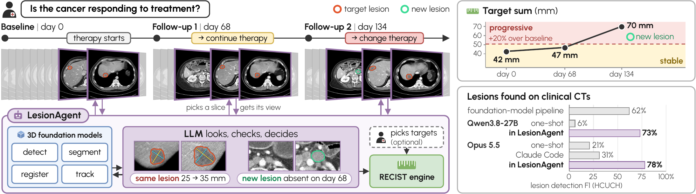

# LesionAgent: Training-Free Agentic Tumor Tracking and Response Assessment in Longitudinal CT

<div align="center">

[](https://arxiv.org/abs/2611.27876)&#160;
[](https://github.com/MIC-DKFZ/LesionAgent)&#160;
[](LICENSE)&#160;
[](#napari-app)

</div>



This repository contains the official implementation of our paper:

### **LesionAgent: Training-Free Agentic Tumor Tracking and Response Assessment in Longitudinal CT**

LesionAgent is an **LLM agent that reads a cancer patient's CT scans end to end**, from the images to the RECIST 1.1 response at every visit, **without any task-specific training**. It operates frozen **3D foundation models as tools**, acts in 3D through **coordinate-labelled views**, remembers every lesion across visits in a **lesion registry**, **verifies every model output** it relies on, and leaves every number to a **deterministic guideline engine**. On a **single scan** it finds, segments and measures the lesions, and the task can be changed in plain text. The harness is **model-agnostic**: it runs with Claude or with an open-weight LLM that can stay inside the hospital.

> **Authors**: Maximilian Rokuss, Jeya Maria Jose Valanarasu, Alejandro Lozano, Benjamin Hamm, Yannick Kirchhoff, Fabian Isensee, Klaus Maier-Hein  
> **Paper**: [](https://arxiv.org/abs/2611.27876)

---

## 📰 News

- **11/2026**: 🚀 Code released: the harness with the 18 tools, the RECIST skill, the guideline engine, a CLI and a Python API
- **11/2026**: 📄 Preprint released on [arXiv](https://arxiv.org/abs/2611.27876)!

---

## Overview

Every few months, a cancer patient's CT scans decide whether treatment continues. 3D foundation models can now detect, segment, register and track lesions, yet none of them reads the scans as a radiologist does. A radiologist decides **which findings are lesions**, **which are the same lesion months later** and **whether a new spot means progression**, and checks each decision against the rules of a clinical guideline.

LesionAgent splits this read by the kind of decision:

- **3D foundation models perceive** the lesions: [VoxTell](https://github.com/MIC-DKFZ/VoxTell) detects, [nnInteractive](https://github.com/MIC-DKFZ/nnInteractive) segments, [uniGradICON](https://github.com/uncbiag/uniGradICON) registers, [LongiTrack](https://huggingface.co/ykirchhoff/LongiTrack) tracks and [TotalSegmentator](https://github.com/wasserth/TotalSegmentator) assigns organs.
- **The LLM judges** what the models cannot: is a finding a lesion, is it the same lesion at the next visit, is a new finding real, and which lesions should be followed? It checks every mask in rendered views, and a second model re-segments each mask to catch failures.
- **A deterministic guideline engine measures** the lesions on their masks and applies RECIST 1.1, so the LLM never computes a number or a response category.


At baseline, VoxTell proposes lesion candidates and the agent accepts or rejects each one. Every accepted lesion enters the registry (lesions × visits), which holds its mask at every visit. At each follow-up, registration carries every lesion into the new scan, where LongiTrack segments it. A finding that matches no tracked lesion becomes a new lesion only after the agent has checked the same position at baseline. The agent acts only through **18 typed tools**:

| Group | Tools (model) |
|---|---|
| Perception | `detect` (VoxTell), `segment` (nnInteractive / LongiTrack), `track_all` (uniGradICON + LongiTrack), `refine_lesion` (nnInteractive), `edit_mask`, `totalsegmentator` (TotalSegmentator) |
| Inspection | `study_info`, `view`, `view_pair`, `inspect` |
| Registry | `review_candidates`, `update_lesion`, `set_visit_judgement` |
| Decision | `score_lesions`, `propose_targets`, `set_targets`, `recist_report` (engine) |
| Human | `ask_clinician` |

---

## ✨ Highlights

- 🤖 **Runs with any LLM**: one harness with the same tools and skill for every model. Use Claude, or an open-weight LLM (e.g. Qwen3.8-27B) served with [vLLM](https://github.com/vllm-project/vllm), so the whole read can stay inside the hospital.
- 🧊 **Training-free**: frozen 3D foundation models as tools, no task-specific training. All tools run on a single 24 GB GPU.
- 🔎 **One scan or many**: on a single scan, LesionAgent finds, segments and measures the lesions. On 436 lung screening CTs it measured nodules as closely as the radiologists agree with each other and reported fewer false positives, but found fewer nodules.
- 🧾 **Every number traceable**: a deterministic guideline engine computes every measurement and RECIST 1.1 category from the lesion masks, and every lesion, tool call and decision behind the response stays visible.
- 🩺 **Clinician in the loop**: read fully automatically, or together with the clinician in the [napari app](#napari-app) (coming soon).
- 📈 **Strong results**: on four public longitudinal CT datasets, LesionAgent tracks more lesions and measures them more accurately than every automatic baseline. See the [paper](https://arxiv.org/abs/2611.27876) for all results.

---

<a id="napari-app"></a>

## 🖥️ The napari Reading App

🚧 **Coming soon.** LesionAgent comes with a reading app for [napari](https://napari.org/) that works with any LLM. The clinician watches the read live and sees every lesion, tool call and number behind the response, answers the agent's questions (e.g. which target set to use when two valid sets give different responses) and can correct any decision. The RECIST report updates from the registry after every change.


---

## 🛠 Installation

```bash
pip install git+https://github.com/MIC-DKFZ/LesionAgent.git
lesionagent setup
```

LesionAgent needs Python 3.11 or 3.12 and an NVIDIA GPU with 24 GB. `lesionagent setup` checks the GPU, downloads all model weights and sends a test message to the LLM. If pip installs a PyTorch build that does not match your NVIDIA driver, install [PyTorch](https://pytorch.org/get-started/locally/) first.

---

## 🚀 Getting Started

Give LesionAgent one patient's CT scans (NIfTI) in chronological order, baseline first, with the days since baseline:

```bash
lesionagent run --images baseline.nii.gz followup1.nii.gz followup2.nii.gz --days 0 63 126
```

The agent reads all visits and prints what it does. The output folder (`--out`, default `./runs/<time>`) then holds:

| File | Content |
|---|---|
| `report.md`, `report.json` | the RECIST 1.1 report: sum of diameters, changes and response per visit, best overall response |
| `summary.md` | the agent's own summary: targets and why, confidence, what a radiologist should double-check |
| `result/` | the lesion registry (`registry.json`) and one label map per visit (`masks/`) |
| `renders/` | every image the agent looked at |
| `transcript.jsonl`, `log.jsonl`, `run.json` | every message and tool call, and the settings of the read |

The same read from Python:

```python
from lesionagent import Study, read

study = Study.from_files(["baseline.nii.gz", "followup1.nii.gz"], days=[0, 63])
result = read(study, out="runs/patient1")
print(result.report["best_overall_response"])
```

### A single scan and other tasks

```bash
lesionagent run --images ct.nii.gz --task lesions           # find, segment and measure every lesion
lesionagent run --images chest.nii.gz --task lung-nodules   # the lung nodule task of the paper
```

Without `--task`, LesionAgent does the full RECIST 1.1 read. `lesions` reports every lesion the agent has checked, of any kind and size, benign ones included, with a confidence for each. `--task` also takes a text file or the task text itself; the [built-in tasks](src/lesionagent/tasks) are examples. The masks are in `result/masks/` (one label per lesion) and the measurements in `result/registry.json`. In Python: `read(study, task="lesions")`.

### Choosing the LLM

| You have | You do |
|---|---|
| A Claude subscription | log in once with [Claude Code](https://claude.com/claude-code) (`claude`), then `lesionagent run ...` |
| An Anthropic API key | `export ANTHROPIC_API_KEY=...` or `--api-key-file FILE` |
| An open-weight LLM on your own server | `lesionagent run ... --llm-url http://localhost:8000 --model Qwen/Qwen3.8-27B` |
| A ChatGPT subscription | log in once with [Codex](https://github.com/openai/codex) (`codex login`), then `lesionagent run ... --llm codex` |
| A Google account with Antigravity | log in once with `agy`, then `lesionagent run ... --llm agy` |

`--llm` (or `backend` under `[llm]` in `lesionagent.toml`) selects the client: `claude` (default), `codex` or `agy`. All of them use the same tools, skill and outputs; the rendered views go to the provider of the model you choose.

`--llm-url` takes any server that speaks the Anthropic Messages API, such as [vLLM](https://github.com/vllm-project/vllm). The model must see images, also inside tool results, and call tools. `--model` and `--effort` choose the model and its reasoning effort (default: `opus`, `high`). Current open-weight LLMs complete the read, but their results are weaker than frontier models.

The LLM sees rendered views of the scans. With Claude they are sent to Anthropic, so use only images you may share. With your own server every image stays on your hardware.

### Pinning model versions

By default LesionAgent uses the newest release of every model. To pin versions, put a `lesionagent.toml` into the folder you run from (or pass `--config FILE`); [`lesionagent.example.toml`](lesionagent.example.toml) is a template. Every entry is optional:

```toml
[models]
voxtell = "voxtell_v1.1"
nninteractive = "nnInteractive_v1.0"
longitrack = "1.0"

[llm]
model = "opus"
effort = "high"
```

These are the versions used in the paper, with Claude Opus 5.5 at high effort and Qwen3.8-27B at medium effort.

---

<a id="roadmap"></a>

## 🗺️ Roadmap

- [x] **Paper Published**: [arXiv:2611.27876](https://arxiv.org/abs/2611.27876)
- [x] **Code Release**: the LesionAgent harness, with the lesion registry, the 18 tools, the RECIST skill and the guideline engine
- [x] **CLI & Python API**: read any series of CT scans (NIfTI), fully automatically or with a clinician
- [ ] **napari Reading App**: live reads with the clinician in the loop
- [ ] **More tasks and tools**: further lesion tasks and guidelines beyond RECIST 1.1

---

## More Related Code Releases

LesionAgent builds on our 3D foundation models. Check them out:

- [**VoxTell**](https://github.com/MIC-DKFZ/VoxTell): free-text promptable universal 3D medical image segmentation (CVPR 2026). &nbsp; [](https://arxiv.org/abs/2511.11450)
- [**nnInteractive**](https://github.com/MIC-DKFZ/nnInteractive): 3D interactive segmentation across modalities and target structures with points, boxes, scribbles and lassos. &nbsp; [](https://arxiv.org/abs/2503.08373)
- [**LesionLocator**](https://github.com/MIC-DKFZ/LesionLocator): zero-shot universal tumor segmentation and tracking in 3D whole-body imaging (CVPR 2025). &nbsp; [](https://arxiv.org/abs/2502.20985)

---

## 📚 Citation

If you find our work useful, please consider citing:

```bibtex
@article{rokuss2026lesionagent,
      title={LesionAgent: Training-Free Agentic Tumor Tracking and Response Assessment in Longitudinal CT},
      author={Rokuss, Maximilian and Valanarasu, Jeya Maria Jose and Lozano, Alejandro and Hamm, Benjamin and Kirchhoff, Yannick and Isensee, Fabian and Maier-Hein, Klaus},
      journal={arXiv preprint arXiv:2611.27876},
      year={2026}
}
```

---

## 📄 License and Disclaimer

The code is licensed under [Apache-2.0](LICENSE). The weights of VoxTell, nnInteractive and LongiTrack, which a read downloads, are licensed under CC BY-NC-SA 4.0 (non-commercial use only).

LesionAgent is a research tool. It is not a medical device and must not be used for diagnosis, treatment decisions or any other clinical purpose.

---

## 📬 Contact

For questions, issues, or collaborations, please contact:

📧 maximilian.rokuss@dkfz-heidelberg.de

<br>

<p align="center">
  
</p>
