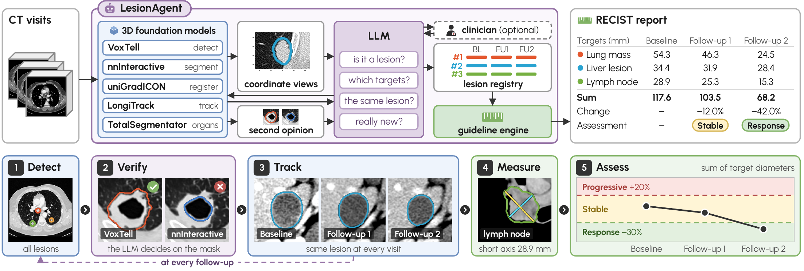
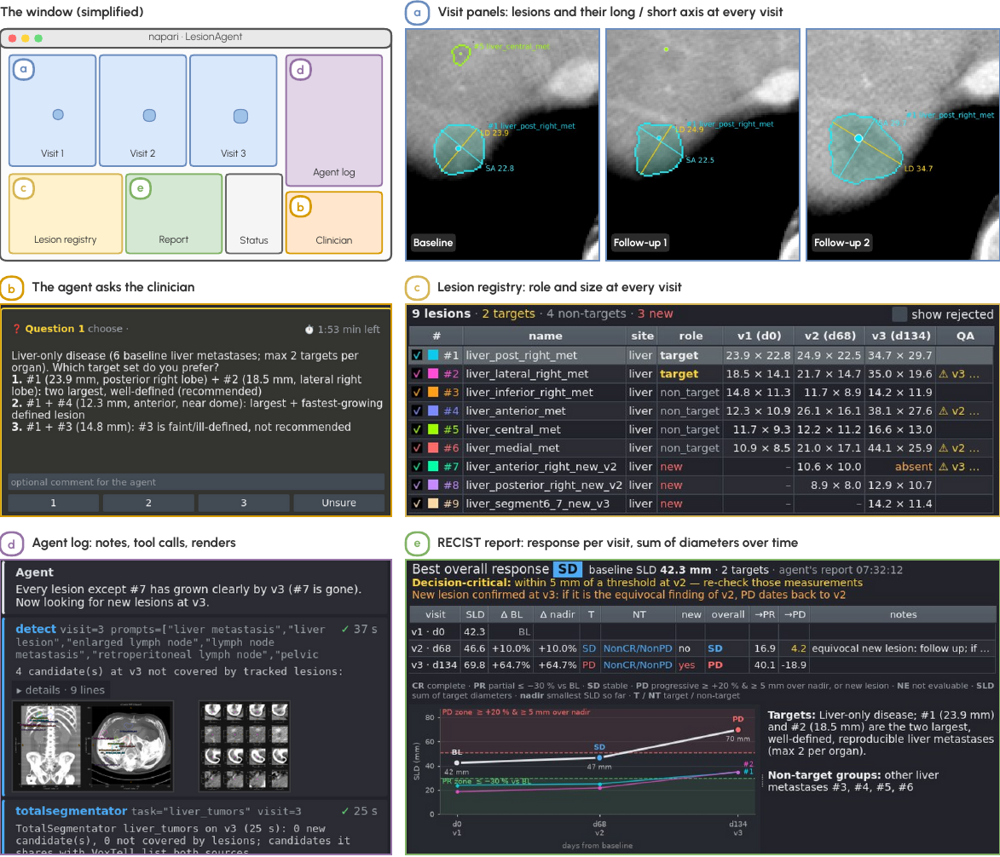

# LesionAgent: Training-Free Agentic Tumor Tracking and Response Assessment in Longitudinal CT

<div align="center">

[](https://arxiv.org/abs/2611.27876)&#160;
[](https://github.com/MIC-DKFZ/LesionAgent)&#160;
[](#roadmap)&#160;
[](#napari-app)

</div>


This repository contains the official implementation of our paper:

### **LesionAgent: Training-Free Agentic Tumor Tracking and Response Assessment in Longitudinal CT**

LesionAgent is an **LLM agent that reads a cancer patient's CT scans end to end**, from the images to the RECIST 1.1 response at every visit, **without any task-specific training**. It operates frozen **3D foundation models as tools**, acts in 3D through **coordinate-labelled views**, remembers every lesion across visits in a **lesion registry**, **verifies every model output** it relies on, and leaves every number to a **deterministic guideline engine**. The harness is **model-agnostic**: it runs with Claude or with an open-weight LLM that can stay inside the hospital.

> **Authors**: Maximilian Rokuss, Jeya Maria Jose Valanarasu, Alejandro Lozano, Benjamin Hamm, Yannick Kirchhoff, Fabian Isensee, Klaus Maier-Hein  
> **Paper**: [](https://arxiv.org/abs/2611.27876)

---

## 📰 News

- **11/2026**: 📄 Preprint released on [arXiv](https://arxiv.org/abs/2611.27876)!

---

## Overview

Every few months, a cancer patient's CT scans decide whether treatment continues. 3D foundation models can now detect, segment, register and track lesions, yet none of them reads the scans as a radiologist does. A radiologist decides **which findings are lesions**, **which are the same lesion months later** and **whether a new spot means progression**, and checks each decision against the rules of a clinical guideline.

LesionAgent splits this read by the kind of decision:

- **3D foundation models perceive** the lesions: [VoxTell](https://github.com/MIC-DKFZ/VoxTell) detects, [nnInteractive](https://github.com/MIC-DKFZ/nnInteractive) segments, [uniGradICON](https://github.com/uncbiag/uniGradICON) registers, [LongiTrack](https://huggingface.co/ykirchhoff/LongiTrack) tracks and [TotalSegmentator](https://github.com/wasserth/TotalSegmentator) assigns organs.
- **The LLM judges** what the models cannot: is a finding a lesion, is it the same lesion at the next visit, is a new finding real, and which lesions should be followed? It checks every mask in rendered views, and a second model re-segments each mask to catch failures.
- **A deterministic guideline engine measures** the lesions on their masks and applies RECIST 1.1, so the LLM never computes a number or a response category.



At baseline, VoxTell proposes lesion candidates and the agent accepts or rejects each one. Every accepted lesion enters the registry (lesions × visits), which holds its mask at every visit. At each follow-up, registration carries every lesion into the new scan, where LongiTrack segments it. A finding that matches no tracked lesion becomes a new lesion only after the agent has checked the same position at baseline. The agent acts only through **18 typed tools**:

| Group | Tools (model) |
|---|---|
| Perception | `detect` (VoxTell), `segment` (nnInteractive / LongiTrack), `track_all` (uniGradICON + LongiTrack), `refine_lesion` (nnInteractive), `edit_mask`, `totalsegmentator` (TotalSegmentator) |
| Inspection | `study_info`, `view`, `view_pair`, `inspect` |
| Registry | `review_candidates`, `update_lesion`, `set_visit_judgement` |
| Decision | `score_lesions`, `propose_targets`, `set_targets`, `recist_report` (engine) |
| Human | `ask_clinician` |

---

## ✨ Highlights

- 🤖 **Runs with any LLM**: one harness with the same tools and skill for every model. Use Claude, or an open-weight LLM (e.g. Qwen3.8-27B) served with [vLLM](https://github.com/vllm-project/vllm), so the whole read can stay inside the hospital.
- 🧊 **Training-free**: frozen 3D foundation models as tools, no task-specific training. All tools run on a single 24 GB GPU.
- 🧾 **Every number traceable**: a deterministic guideline engine computes every measurement and RECIST 1.1 category from the lesion masks, and every lesion, tool call and decision behind the response stays visible.
- 🩺 **Clinician in the loop**: read fully automatically, or together with the clinician in the [napari app](#napari-app).
- 📈 **Strong results**: on four public longitudinal CT datasets, LesionAgent tracks more lesions and measures them more accurately than every automatic baseline. See the [paper](https://arxiv.org/abs/2611.27876) for all results.

---

<a id="napari-app"></a>

## 🖥️ The napari Reading App

LesionAgent comes with a reading app for [napari](https://napari.org/) that works with any LLM. The clinician watches the read live and sees every lesion, tool call and number behind the response, answers the agent's questions (e.g. which target set to use when two valid sets give different responses) and can correct any decision. The RECIST report updates from the registry after every change.



---

## 🛠 Installation & 🚀 Getting Started

🚧 **Coming soon.** 

---

<a id="roadmap"></a>

## 🗺️ Roadmap

- [x] **Paper Published**: [arXiv:2611.27876](https://arxiv.org/abs/2611.27876)
- [ ] **Code Release**: the LesionAgent harness, with the lesion registry, the 18 tools, the RECIST skill and the guideline engine
- [ ] **CLI & Python API**: read any series of CT scans (NIfTI), fully automatically or with a clinician
- [ ] **napari Reading App**: live reads with the clinician in the loop

---

## More Related Code Releases

LesionAgent builds on our 3D foundation models. Check them out:

- [**VoxTell**](https://github.com/MIC-DKFZ/VoxTell): free-text promptable universal 3D medical image segmentation (CVPR 2026). &nbsp; [](https://arxiv.org/abs/2511.11450)
- [**nnInteractive**](https://github.com/MIC-DKFZ/nnInteractive): 3D interactive segmentation across modalities and target structures with points, boxes, scribbles and lassos. &nbsp; [](https://arxiv.org/abs/2503.08373)
- [**LesionLocator**](https://github.com/MIC-DKFZ/LesionLocator): zero-shot universal tumor segmentation and tracking in 3D whole-body imaging (CVPR 2025). &nbsp; [](https://arxiv.org/abs/2502.20985)

---

## 📚 Citation

If you find our work useful, please consider citing:

```bibtex
@article{rokuss2026lesionagent,
      title={LesionAgent: Training-Free Agentic Tumor Tracking and Response Assessment in Longitudinal CT},
      author={Rokuss, Maximilian and Valanarasu, Jeya Maria Jose and Lozano, Alejandro and Hamm, Benjamin and Kirchhoff, Yannick and Isensee, Fabian and Maier-Hein, Klaus},
      journal={arXiv preprint arXiv:2611.27876},
      year={2026}
}
```

---

## 📬 Contact

For questions, issues, or collaborations, please contact:

📧 maximilian.rokuss@dkfz-heidelberg.de
